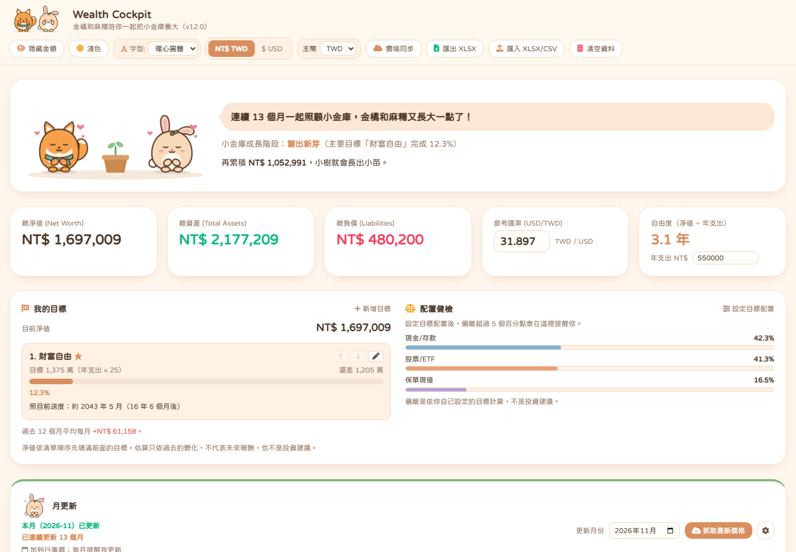
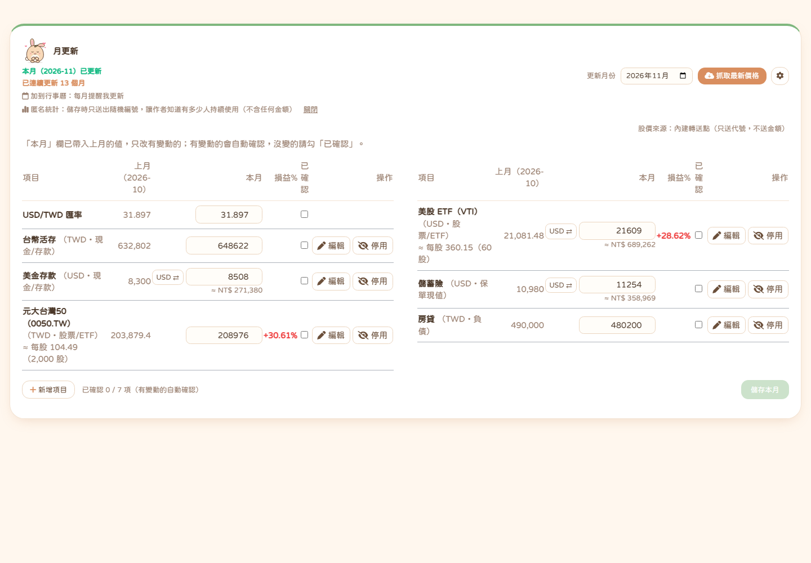
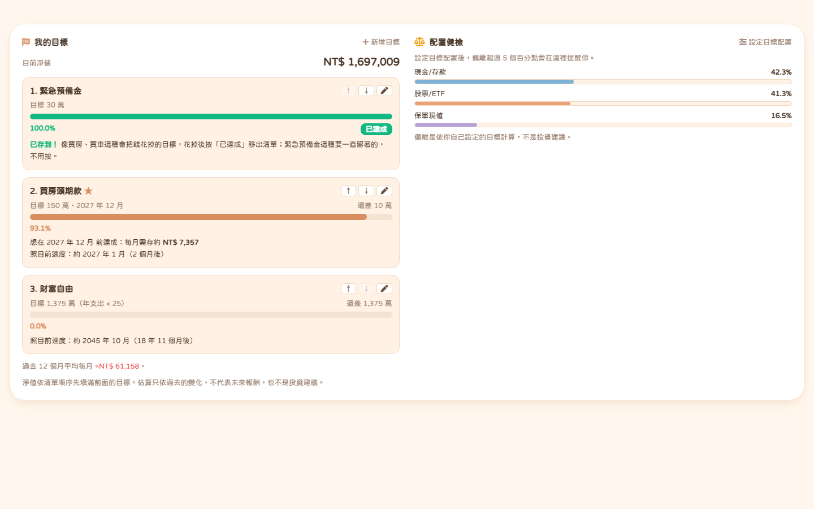
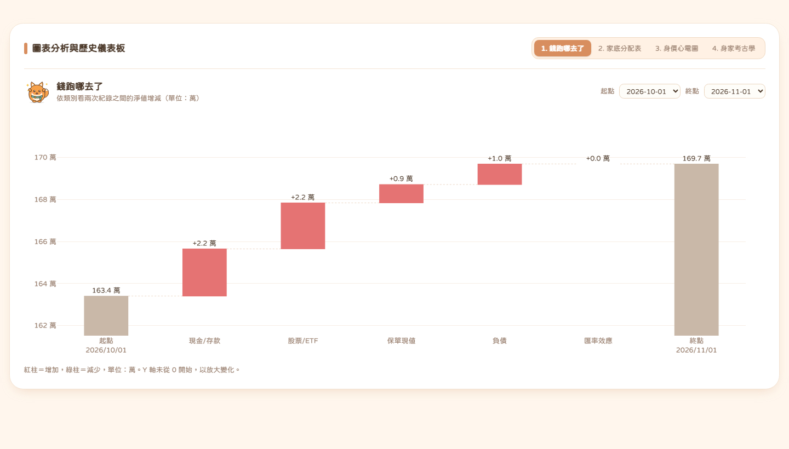
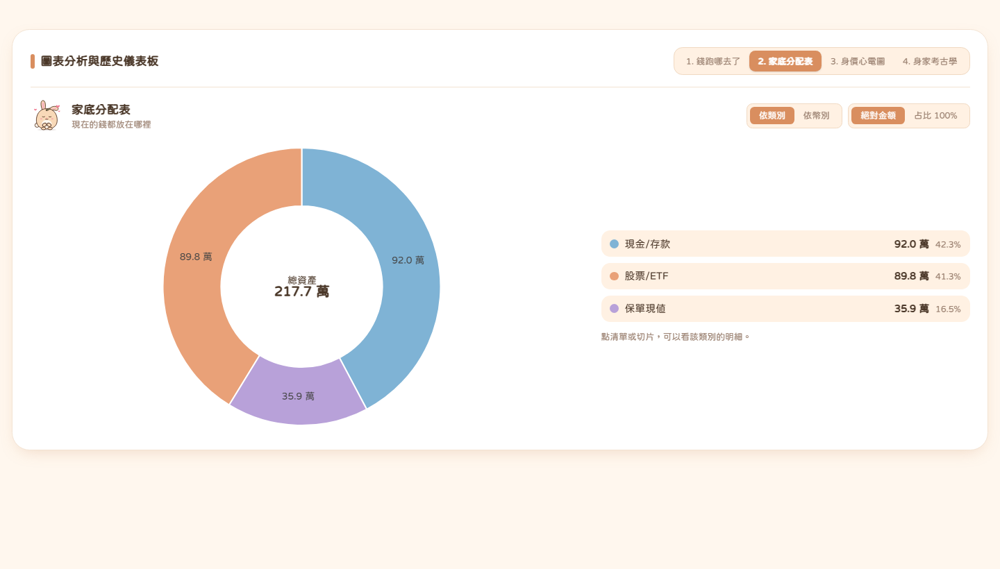
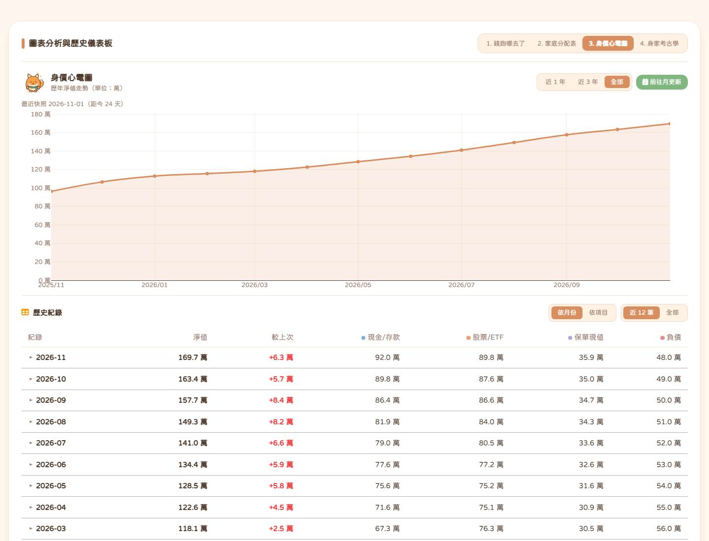
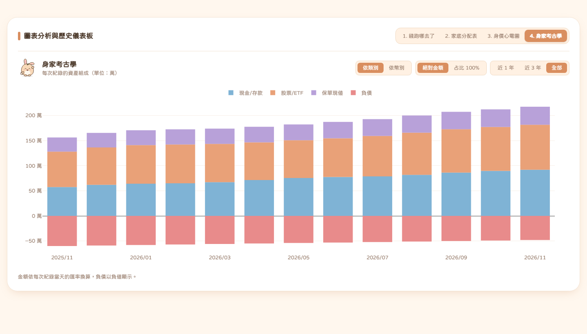
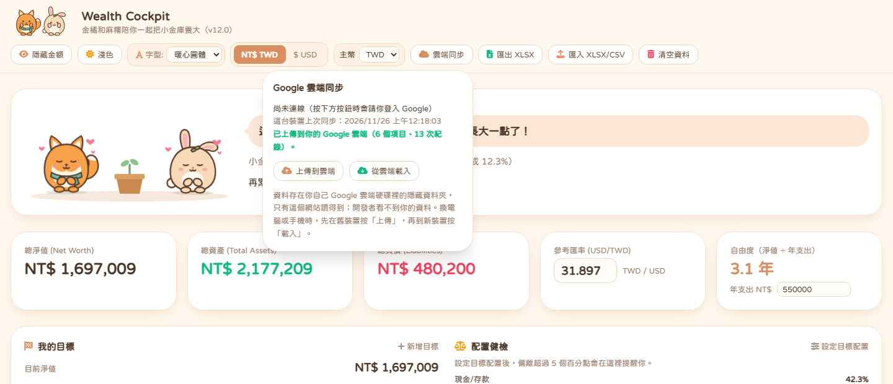
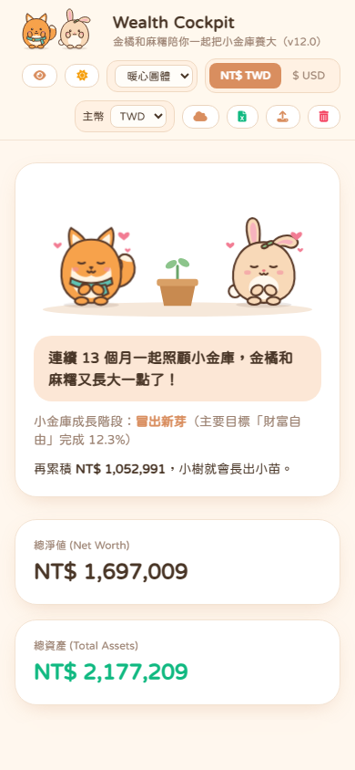

# Wealth Cockpit · 金橘與麻糬的小金庫

> 每月花 5 分鐘記下你的資產，看著小金庫的樹一點一點長大，往你的目標前進。

**立即使用 → https://timmy-practice.github.io/wealth-cockpit/**

免安裝、免註冊，用瀏覽器打開就能用。電腦和手機都可以。

---

## 這是什麼？

一個**手動記錄**的個人資產追蹤工具。你每個月把各帳戶、股票、保單、負債的金額填進去，它會幫你：

- 算出**總淨值**與**財富自由度**（淨值 ÷ 年支出）
- 追蹤你的**多個目標**（緊急預備金、買房頭期款、教育金、財富自由……），告訴你每個目標的進度、**每月要存多少**，以及照目前速度**哪一年能達成**
- 用四張圖告訴你：**錢跑哪去了**、**錢放在哪裡**、**身價怎麼變化**、**資產結構怎麼演變**
- 用一棵會長大的**小金庫樹**陪你：主要目標完成度越高，樹就從種子、新芽，長成結滿金幣、開花的大樹

### 為什麼要「手動」？

| | 自動串接銀行的 App | Wealth Cockpit |
|---|---|---|
| 要給帳號密碼嗎？ | 要授權讀取你的銀行與券商資料 | **完全不用** |
| 資料存在哪？ | 對方公司的伺服器 | **你自己的瀏覽器**（要跨裝置時，存在**你自己的** Google 雲端硬碟） |
| 開發者看得到你的資產嗎？ | 看得到 | **看不到** |

每個月 5 分鐘的手動輸入，換來的是：你的財務資料始終只在你手上。

---

## 三步驟開始

1. **打開網站**：https://timmy-practice.github.io/wealth-cockpit/
2. **先看看範例**（可選）：第一次打開時按「先看範例資料」，看看各種圖表長什麼樣子；看完按右上角「清空資料」即可。
3. **新增你的項目**：在「月更新」區按「新增項目」，把你的帳戶一個一個加進去（例如：台新活存、美股 VTI、儲蓄險、房貸），然後填上這個月的金額，按「儲存本月」。

完成！之後每個月回來更新一次就好。

---

## 每月更新（約 5 分鐘）

- **上個月的數字會自動帶入**，只要改有變動的項目。有改的會自動打勾確認，沒變的就手動勾一下。
- **股票填「總市值」**：如果在項目裡填了股數與平均成本，會自動算出每股價格與**損益 %**（台股慣例：漲紅、跌綠）。
- **外幣項目可以用主幣輸入**：例如銀行 App 把美金存款換算成台幣顯示，按輸入框旁的「USD ⇄」切成 NT$，直接填台幣，會依當月匯率換回美金存起來。
- **一鍵抓匯率與股價**：按「**抓取最新價格**」，會自動填入當天的 USD/TWD 匯率，以及每檔股票的市值（股數 × 最新股價），確認後按「儲存本月」即可。詳見下方說明。
- 不再使用的項目請按「**停用**」而不是刪除，歷史紀錄會保留；之後新增同名項目時可以接回。
- 填錯了？右上角會出現「**復原**」，可以回到儲存前的狀態。

### 股價自動更新

不用設定，填好兩樣東西就能用：

1. 在股票項目的「**編輯**」裡填**股票代碼**和**股數**（要算損益的話再填平均成本）。
2. 每月按「**抓取最新價格**」，市值就會自動算好填入。

股票代碼直接打常見寫法就好，程式會自動判斷是哪個市場：

| 你填 | 程式找到 | 市場 |
|---|---|---|
| `2330`、`0050` | `2330.TW`、`0050.TW` | 台股上市 |
| `6488`、`00679B` | `6488.TWO`、`00679B.TWO` | 台股上櫃（上市查不到時自動改試） |
| `VTI`、`vti` | `VTI` | 美股 |
| `VWRA` | `VWRA.L` | 倫敦（美股查不到時自動改試） |
| `台積電2330` | `2330.TW` | 會自動去掉中文 |

- 新增股票時，如果名稱裡有代碼（例如「台積電2330」）而代碼欄空白，會自動帶入。
- **只填中文名稱（例如「台積電」）查不到**，請填數字代碼。
- 目前只支援**台幣或美元計價**的股票（台股、美股、倫敦的美元計價 ETF 等）。其他市場若是美元計價，請自己加交易所後綴。
- 為了避免抓錯，報價幣別必須和項目幣別一致（例如 VTI 的項目要設成 USD），不一致時會跳過並提醒你。
- **加碼或賣出時**，到「編輯」更新股數與平均成本即可，市值下次抓價時會自動算對。

> 股價來自公開的財經資料，可能有延遲或錯誤，請以券商畫面為準。

---

## 我的目標

每個人存錢的理由不一樣，所以目標由你自己訂：

- 按「**新增目標**」，填名稱、金額，以及希望達成的年月（選填）。財富自由這類目標可以勾選「用年支出 × 25 自動計算」（4% 法則）。
- **依順序填滿**：淨值會先填滿排在前面的目標，多的再給下一個，**同一筆錢不會重複計算**。用 ↑ ↓ 調整先後順序，例如「緊急預備金 → 買房頭期款 → 財富自由」。
- 有填年月的目標，會算出「**每月需存約 X 元**」；如果前面還有沒存滿的目標，會一起算進去。
- 有兩個月以上的紀錄後，會依你實際的成長速度估算**大約哪一年哪個月達成**。
- 標上 ★ 的是**主要目標**，小金庫的樹跟著它長大。
- 買房、買車這種會把錢花掉的目標，存到之後按「**已達成**」，它會移到「已達成的目標」，不再分走你的淨值；緊急預備金這種要一直留著的，不用按。

---

## 四張圖看懂你的錢

### 1. 錢跑哪去了

選兩個時間點，用瀑布圖看這段期間淨值的增減**來自哪一類資產**，匯率變動造成的影響也會單獨列出來。

### 2. 家底分配表

目前的資產分布。可以依類別、幣別切換；**點一下扇形**可以看該類別裡的明細，右鍵返回。

### 3. 身價心電圖

淨值的走勢，下方附完整歷史紀錄。歷史表可以「依月份」或「依項目」檢視；依項目檢視時，底色越紅代表比前一次成長越多，綠色代表減少。

### 4. 身家考古學

每一次紀錄的資產組成，可以切換「絕對金額」或「占比 100%」，看出你的配置隨時間怎麼改變。

---

## 換電腦、換手機：Google 雲端同步

資料預設只存在**目前這個瀏覽器**。要在其他電腦或手機使用：

1. 在**有資料的裝置**：右上角「雲端同步」→「**上傳到雲端**」，第一次會請你登入 Google。
2. 在**新的裝置**：打開同一個網址 →「雲端同步」→「**從雲端載入**」。

- 資料存在你 Google 雲端硬碟裡一個**隱藏的應用程式資料夾**，這個網站只能讀寫它自己的這一個檔案，**看不到你雲端硬碟裡的其他檔案**。
- 如果雲端上的資料被另一台裝置改過，上傳前會先提醒你，避免覆蓋。
- 目前是**手動同步**：在哪台裝置改了資料，記得按一次上傳。

> 目前 Google 登入在測試階段，只開放給受邀的測試使用者。如果你想試用，請聯絡作者。

---

## 手機也能用

用手機瀏覽器打開同一個網址即可，版面會自動調整。

---

## 匯入與匯出

- **匯出 XLSX**：把全部資料存成 Excel 檔備份。建議每個月更新完順手匯出一次。
- **匯入 XLSX / CSV**：從備份檔還原，或從其他電腦搬資料過來（匯入會取代目前資料，可以按「復原」退回）。

匯出的 Excel 每個工作表就是一次紀錄，工作表名稱是日期（例如 `2026-11-01`）：

| 位置 | 內容 |
|---|---|
| A1 / B1 | `fx_usd_twd` / 當次的 USD 對 TWD 匯率 |
| 第 3 列 | 欄位名稱：`item_id`, `name`, `category`, `currency`, `amount`, `note`, `shares`, `cost_per_share`, `ticker`, `disabled` |
| 第 4 列以後 | 每個項目一列；`category` 可填 `Cash`、`Stock`、`Crypto`、`Insurance`、`Liability` |

---

## 其他功能

- **隱藏金額**：在公共場所打開時，一鍵把所有金額模糊化。
- **主幣設定**：選擇 TWD 或 USD 作為主要幣別；上方的 NT$ / USD 切換可以臨時看另一種幣別。
- **配置健檢**：設定你理想的資產配置比例，偏離超過 5 個百分點時會提醒你。
- **深色 / 淺色主題**與多種字型。

---

## 隱私與資料安全

- 所有資料只存在**你的瀏覽器**（localStorage）；使用雲端同步時，存在**你自己的 Google 雲端硬碟**。
- **開發者收不到、也看不到任何人的資產資料**。
- **匿名使用統計**：按「儲存本月」時，會送出一個這台裝置的**隨機編號**給作者的統計服務，月份由伺服器決定，用來了解有多少人持續每月使用。**不包含任何金額、項目、名字或 email**。不想分享的話，在「月更新」區按「匿名統計：關閉」即可。
- 抓取價格時，只會送出「美金對台幣」的匯率查詢與**股票代碼**（例如 `2330`、`VTI`），**不會送出任何股數、金額或個人資料**。
- 清除瀏覽器資料會讓資料消失，請記得**定期匯出備份**或使用雲端同步。

---

## 常見問題

**Q：換了瀏覽器或清除瀏覽紀錄，資料不見了？**
資料存在個別瀏覽器裡。請用「匯入 XLSX」還原備份，或用「雲端同步 → 從雲端載入」。

**Q：Google 登入時出現「Google 尚未驗證這個應用程式」？**
目前在測試階段，這是正常的提示，按「繼續」即可。

**Q：按「抓取最新價格」後，某檔股票顯示「查無報價」？**
請確認填的是數字代碼（例如 `2330`）而不是中文名稱。若是美股、倫敦以外的市場，需要自己加交易所後綴；目前只支援台幣或美元計價的股票。

**Q：股票代碼被自動改成 `2330.TW` 了？**
這是正常的，代表程式已經找到正確的市場，下次會直接用這個代碼抓價。

**Q：可以記錄美金以外的外幣嗎？**
目前只支援台幣與美金。

**Q：圖表或預估的數字可以當作投資建議嗎？**
不行，請見下方說明。

---

## 免責聲明

本工具僅供個人記錄與整理資產，所有圖表、預估與提醒都只是依你輸入的數字計算，**不構成任何投資建議**。投資有風險，請自行判斷。

---

© 2026 Timmy-practice. 保留所有權利。未經同意請勿重製、修改後散布或用於商業用途。
